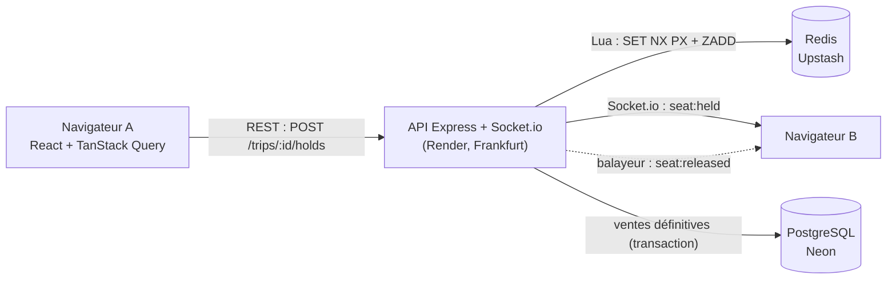

# Billetterie de cars en temps réel

[](https://github.com/Tening2283/billeterie/actions/workflows/ci.yml)

Réservation de places de cars interurbains (Dakar, Thiès, Saint-Louis…) sur un plan du car mis à jour en direct : quand un voyageur choisit une place, tous les autres la voient passer en « bloquée » en moins d'une seconde. Blocage de 10 minutes, billets à QR code signé, contrôle à la montée.

**Démo : [billetterie-xi.vercel.app](https://billetterie-xi.vercel.app)** — boutons « Essayer en voyageur / en contrôleur », sans inscription. L'API gratuite (Render) s'endort après 15 min sans visite : la première ouverture peut prendre ~50 s (un bandeau le signale).

<!-- GIF de 20 s : deux navigateurs côte à côte, une place qui change d'état dans l'autre → docs/demo.gif -->

## Ce que le projet démontre

- **Temps réel** : Socket.io, une salle par trajet ; la place bloquée apparaît chez les autres en ~170 ms en production.
- **Blocage temporaire** : 10 min dans Redis (`SET NX PX` dans un script Lua), libéré automatiquement et annoncé à tous.
- **Zéro double vente, prouvée** : tests de concurrence sur vraie PostgreSQL et vrai Redis, et test de charge (chiffres plus bas).
- **En ligne et fiable** : CI GitHub (lint, types, tests avec seuil de couverture, build), erreurs affichées proprement, déploiement après CI verte.

## Architecture



Le voyageur A bloque une place en REST ; l'API pose le verrou dans Redis puis prévient la salle du trajet par Socket.io. PostgreSQL ne reçoit que les ventes définitives. Front sur Vercel ; API, base et Redis dans la même région (Frankfurt).

```
apps/api/         Express 5, Prisma 7 + PostgreSQL, Redis (ioredis), Socket.io, pino
apps/web/         React 19 + Vite + TanStack Query + React Router + Tailwind
packages/shared/  Schémas Zod et types partagés par l'API et le front
```

## Décisions techniques

| Question                                                       | Choix                                                                                                            | Pourquoi                                                                                                                                                                                                                                                                        |
| -------------------------------------------------------------- | ---------------------------------------------------------------------------------------------------------------- | ------------------------------------------------------------------------------------------------------------------------------------------------------------------------------------------------------------------------------------------------------------------------------- |
| Où vivent les places bloquées ?                                | Dans Redis, pas en base                                                                                          | Elles sont temporaires : une clé avec expiration (`PX 600000`) disparaît seule. La base ne contient que le définitif.                                                                                                                                                           |
| Comment éviter que deux personnes bloquent la même place ?     | `SET hold:{trajet}:{place} {user} NX PX` dans un script Lua, avec le plafond de 4 places et l'échéance (`ZADD`)  | `NX` + `PX` en une commande : atomique même avec 1 000 clics simultanés. Un `GET` puis un `SET` laisserait passer deux gagnants.                                                                                                                                                |
| Relâcher une place sans supprimer celle d'un autre ?           | Script Lua « comparer puis supprimer »                                                                           | Entre un `GET` et un `DEL` en JavaScript, le blocage peut expirer et être repris par quelqu'un d'autre.                                                                                                                                                                         |
| Comment prévenir quand un blocage expire ?                     | Un balayeur dans l'API (ensemble trié `holds:expiry`), pas les notifications d'expiration de Redis               | Les notifications sont perdues si l'API est déconnectée et arrivent parfois en retard. Le balayeur dort jusqu'à la prochaine échéance connue (et vérifie toutes les 60 s) au lieu d'interroger Redis toutes les 5 s : le quota gratuit d'Upstash est limité.                    |
| Et si Redis tombe ou perd une clé ?                            | Index unique partiel en base : `UNIQUE (trip_id, seat_number) WHERE status <> 'cancelled'`                       | La base reste la garantie finale. Test : 50 insertions simultanées sur la même place sans passer par Redis → une seule réussit. Partiel, pour qu'un billet annulé libère la place.                                                                                              |
| Une vente et un blocage au même instant ?                      | Après un blocage réussi, on revérifie la base ; si la place vient d'être vendue, on relâche aussitôt             | Évite d'afficher « bloquée » sur une place déjà vendue.                                                                                                                                                                                                                         |
| Double clic sur « Confirmer », réseau qui renvoie la requête ? | En-tête `Idempotency-Key` (unique par utilisateur)                                                               | La même clé renvoie la même réservation (`Idempotent-Replayed: true`) au lieu d'en créer une deuxième. Le front garde la clé entre deux essais tant que les noms ne changent pas.                                                                                               |
| Rôle de Socket.io ?                                            | Seulement prévenir ; toutes les actions passent par l'API REST                                                   | Les actions restent validées, testées, avec un code HTTP clair. À chaque reconnexion, le front recharge les places : il a pu manquer des événements. Aucun événement ne contient l'identité d'un utilisateur.                                                                   |
| Comment empêcher les faux billets ?                            | Code = `base64url(id).base64url(HMAC-SHA256(secret, id))`, comparé avec `timingSafeEqual`                        | Sans le secret du serveur, impossible de fabriquer un billet. Le contrôle est un seul `UPDATE … WHERE status = 'valid' RETURNING` : deux contrôleurs qui scannent à la même seconde obtiennent « valide » et « déjà utilisé ».                                                  |
| Où garder le jeton de connexion ?                              | `localStorage`, jeton JWT d'1 h                                                                                  | Front (vercel.app) et API (onrender.com) sont sur deux domaines : les cookies tiers sont de plus en plus bloqués. En contrepartie : durée courte, CSP stricte sur Vercel, aucun `dangerouslySetInnerHTML`. Avec un domaine commun, un cookie `httpOnly` redeviendrait possible. |
| Comment garder front et API d'accord ?                         | Schémas Zod dans `packages/shared`                                                                               | Un schéma = validation côté API + types et validation des formulaires côté front. Les réponses de l'API sont aussi validées par le front.                                                                                                                                       |
| Comment tester ?                                               | Tests d'intégration sur vraie PostgreSQL et vrai Redis (pas de simulations)                                      | Les garanties viennent de la base et de Redis : les simuler ne prouverait rien. Tables et clés de test sont vidées entre deux tests (préfixe de clés par environnement).                                                                                                        |
| Où héberger ?                                                  | Vercel (front), Render (API), Neon (PostgreSQL), Upstash (Redis), tous gratuits ; API, base et Redis à Frankfurt | Render gère les WebSockets. Base et Redis à côté de l'API : chaque blocage fait plusieurs allers-retours. La démo crée elle-même ses départs des 14 prochains jours au démarrage, puis toutes les 6 h.                                                                          |

## Résultats mesurés

### Test de charge : ruée sur une même place

<!-- RÉSULTATS DU WORKFLOW « Test de charge » -->

**Méthode.** Workflow GitHub Actions [« Test de charge »](.github/workflows/load-test.yml), lancé à la main : l'API (build de production), PostgreSQL 18 et Redis 7 tournent sur la même machine GitHub, pour mesurer l'appli et non le réseau. Le script [`apps/api/load/hold-rush.ts`](apps/api/load/hold-rush.ts) crée des voyageurs, puis pour chaque manche :

1. [autocannon](https://github.com/mcollina/autocannon) envoie N `POST /trips/:id/holds` sur **la même place**, chacun au nom d'un voyageur différent, avec 100 connexions simultanées ;
2. tous les voyageurs tentent ensuite `POST /bookings` sur cette place au même instant ;
3. à la fin, une requête SQL compte les places vendues deux fois sur toute la base.

Les limitations de débit sont levées pour ce test (`DISABLE_RATE_LIMITS=true`, refusé par l'API en production). Render gratuit n'est pas utilisé pour la mesure : trop lent et partagé.

### Temps réel en production

Un client bloque une place sur l'API de production ; un second client, abonné à la salle du trajet, reçoit `seat:held` **~170 ms** après le clic (mesuré depuis Dakar, API à Frankfurt).

### Tests automatisés

- **API** : tests d'intégration sur vraie PostgreSQL et vrai Redis, chaque route avec ses cas d'erreur (400, 401, 403, 404, 409), dont les trois tests de concurrence : N voyageurs bloquent la même place (un seul 201), 50 ventes simultanées sans Redis (une seule réussit), double scan d'un billet (un « valide », un « déjà utilisé »).
- **Front** : Testing Library, socket simulé : le plan affiche les quatre états, un 409 déclenche le toast, les événements temps réel mettent le plan à jour, l'expiration d'un blocage est signalée.
- **Couverture** : seuil de 80 % imposé par la CI dans chaque paquet (API ~99 %, front ~97 %).

## Lancer en local

Prérequis : Node.js 22, une base PostgreSQL (Neon : une branche `dev`, une branche `test`) et un Redis (Upstash, ou Memurai sous Windows). Dev et tests peuvent partager le même Redis grâce à `REDIS_KEY_PREFIX` (`dev:` / `test:`).

```bash
npm install                                   # génère aussi le client Prisma
cp apps/api/.env.example apps/api/.env        # URL de la branche dev
cp apps/api/.env.example apps/api/.env.test   # URL de la branche test, NODE_ENV=test

npm run db:migrate -w @billetterie/api        # applique les migrations sur dev
npm run db:seed -w @billetterie/api           # lignes, cars, comptes et départs de démo

npm run dev:api   # http://localhost:3000/api/v1/health
npm run dev:web   # http://localhost:5173 (Vite relaie /api et /socket.io vers l'API)
```

**Sur un téléphone** (même réseau que le PC, par exemple son partage de connexion) : `npm run dev:web:phone`, puis ouvrir l'adresse « Network » affichée. En http, la caméra du contrôle est bloquée par le navigateur : coller le code du billet (sous chaque QR). En production (https), le scan fonctionne.

Sans le front : **http://localhost:3000/dev/** dans deux onglets (page de test minimale, servie seulement en développement).

Vérifications (identiques à la CI) :

```bash
npm run lint
npm run format:check
npm run typecheck
npm run test:coverage   # vraie base de test (.env.test) ; échoue sous 80 % de couverture
npm run build
```

Les tests d'intégration vident la base de test entre deux tests : ils refusent de démarrer si `NODE_ENV` ne vaut pas `test`.

Test de charge en local (chiffres limités par le réseau si la base et Redis sont distants) : lancer une API avec `DISABLE_RATE_LIMITS=true BCRYPT_COST=4 LOG_LEVEL=warn`, puis `LOAD_BASE_URL=http://localhost:3000 LOAD_REQUESTS=150 npm run load:test -w @billetterie/api`.

## Comptes de démo

| Rôle       | Accès                            | Ce qu'on peut faire                                                                            |
| ---------- | -------------------------------- | ---------------------------------------------------------------------------------------------- |
| Voyageur   | bouton « Essayer en voyageur »   | Chercher un trajet, bloquer 1 à 4 places, saisir les passagers, recevoir les billets à QR code |
| Contrôleur | bouton « Essayer en contrôleur » | Scanner un QR (caméra) ou coller un code : « valide », « déjà utilisé » ou « faux billet »     |

Les comptes de démo sont partagés : deux personnes connectées au même compte sont vues comme une seule (une place bloquée par l'une apparaît « bloquée par vous » chez l'autre). Pour voir « bloquée par un autre voyageur », créer un compte avec « Inscription ».

## Limites connues (assumées)

- **Comptes de démo publics.** N'importe qui peut obtenir un jeton voyageur ou contrôleur, comme le veut une démo en libre accès : quelqu'un qui obtient le QR code d'un autre (capture d'écran) peut le faire passer à « utilisé » avec le contrôleur de démo. En vrai service, les contrôleurs seraient de vrais comptes et la démo remise à zéro chaque nuit. Les adresses `@demo.test` sont réservées : personne ne peut s'inscrire avec.
- **Une seule instance de l'API.** Les limitations de débit sont en mémoire et Socket.io n'a pas d'adaptateur Redis : pour plusieurs instances, il faudrait `@socket.io/redis-adapter`, un stockage Redis pour `express-rate-limit` et un verrou sur le balayeur.
- **Redis non « cluster ».** Le script Lua de blocage lit les places d'un trajet et l'ensemble trié global `holds:expiry` en une fois : correct sur un Redis à un seul nœud (Upstash régional, Memurai), pas sur Redis Cluster (erreur `CROSSSLOT`).
- **Pas de paiement.** Confirmer vaut paiement dans le MVP.
- **Prévisualisations Vercel.** L'API n'autorise (CORS) que le domaine principal du front : les URL de prévisualisation des pull requests affichent le site mais ne peuvent pas appeler l'API.
